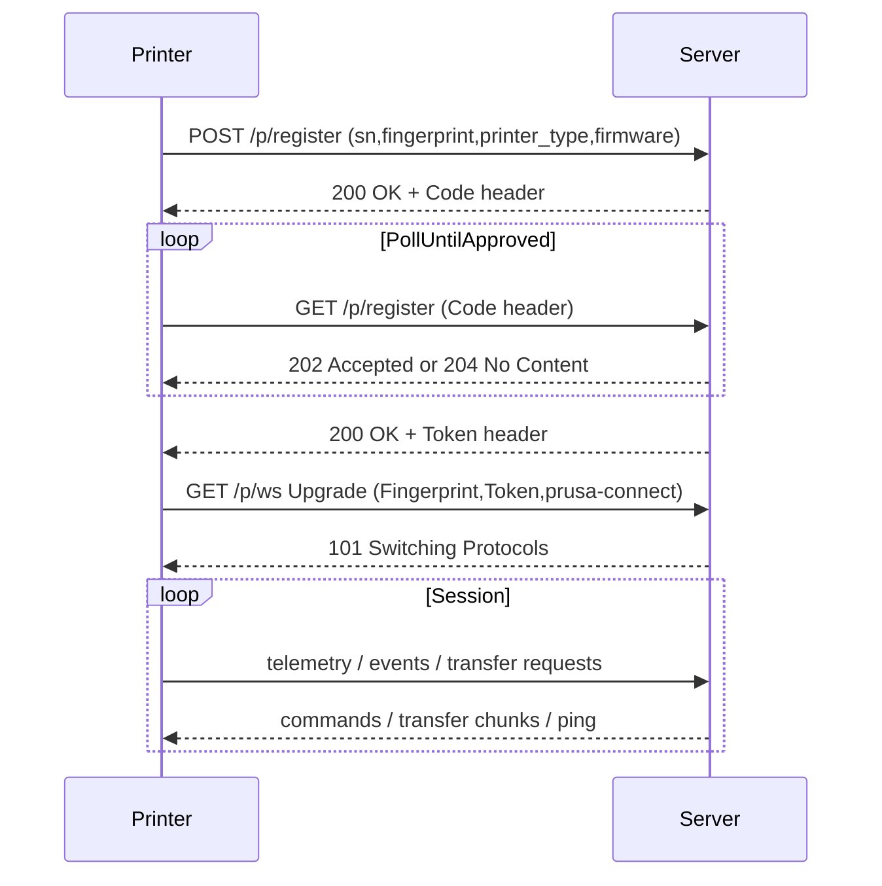
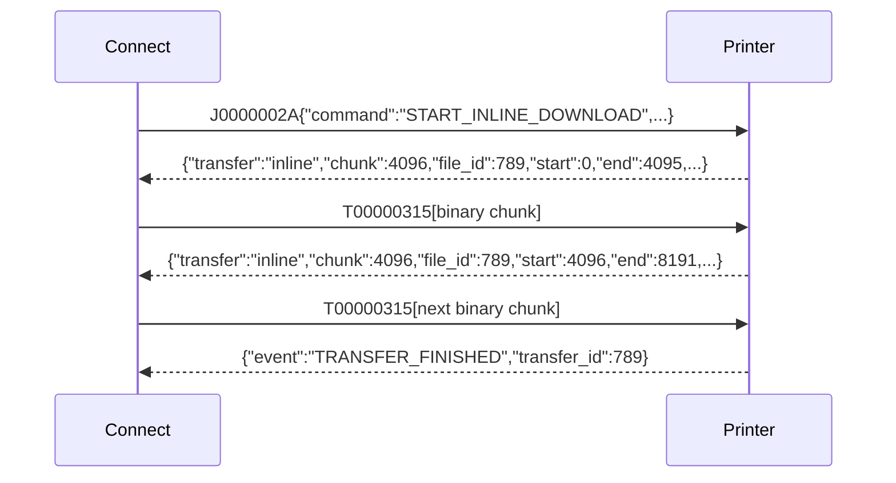
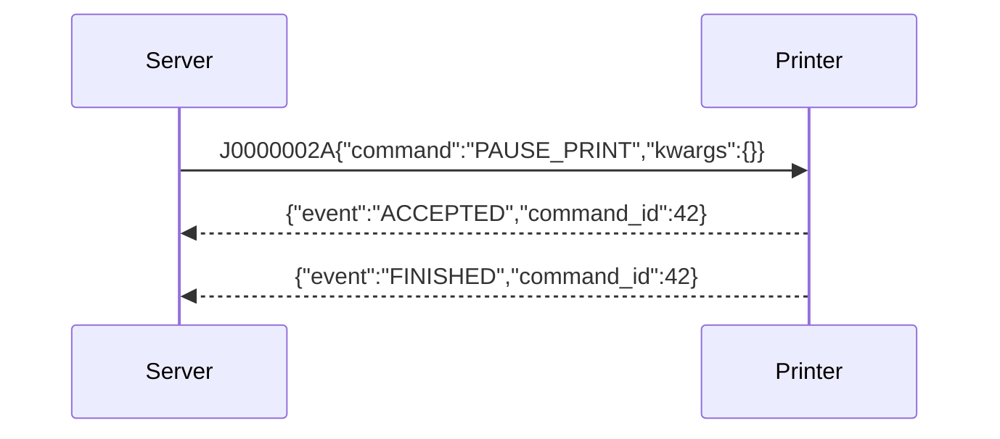

This page documents the printer-facing protocol used by Prusa firmware when talking to a compatible server implementation. It covers the full flow from registration through authenticated WebSocket communication, including message framing, JSON payloads, command IDs, transfer requests, and binary file chunks.

The primary sources of truth for this document are:
- firmware in `Prusa-Firmware-Buddy/src/connect/`
- observed protocol behavior mirrored in compatible server implementations and simulators

## Scope and terminology

In the firmware sources, the negotiated WebSocket subprotocol is named `prusa-connect`. That is the actual wire-level token sent during upgrade.

The term `xBuddy` here refers to the printer-facing protocol context used by Buddy/xBuddy based printers. It does **not** refer to the separate xBuddy extension hardware buses used elsewhere in firmware.

## Source of truth

Normative behavior is derived primarily from firmware-side implementation details:

- Firmware:
  - `src/connect/connect.cpp`
  - `src/connect/render.cpp`
  - `src/connect/command.cpp`
  - `src/connect/planner.cpp`
  - `src/connect/registrator.cpp`
  - `src/common/http/websocket.hpp`
  - `src/common/http/websocket.cpp`
  - `src/connect/tls/tls.cpp`

## End-to-end flow

The printer-facing flow has two phases:

1. Registration over HTTP.
2. Authenticated command and telemetry exchange, typically over WebSocket.



## HTTP registration flow

### `POST /p/register`

The firmware starts registration by sending a JSON body to `POST /p/register`.

Observed firmware fields:

| Field | Type | Meaning |
|---|---|---|
| `sn` | string | Printer serial number |
| `fingerprint` | string | Printer fingerprint |
| `printer_type` | string | Device type ID in `X.Y.Z` format |
| `firmware` | string | Firmware version string |

Example request body:

```json
{
  "sn": "CZPX1234X009XC12345",
  "fingerprint": "0123456789abcdef0123456789abcdef0123456789abcdef01",
  "printer_type": "1.4.0",
  "firmware": "6.4.0"
}
```

Expected response:

- HTTP `200 OK`
- `Code` header containing a registration code

### `GET /p/register`

The firmware then polls `GET /p/register` with a `Code` header until approval completes.

Request header:

```http
Code: ABCD-EFGH
```

Expected responses:

- `202 Accepted` or `204 No Content`: registration still pending
- `200 OK` with `Token` header: registration completed

Example successful response headers:

```http
HTTP/1.1 200 OK
Token: 1234567890abcdef1234567890abcdef12345678
```

## TLS and authentication

### TLS behavior in firmware

Firmware enforces:

- TLS 1.2 only
- certificate verification required
- cipher suite `TLS_ECDHE_ECDSA_WITH_AES_128_GCM_SHA256`

It supports two CA modes:

- built-in certificates compiled into firmware
- custom DER certificate loaded from `/internal/connect/connect.der`

Important notes:

- custom certificate is DER only, not PEM
- hostname verification is enabled with `mbedtls_ssl_set_hostname()`
- certificate verification failure aborts the connection

### WebSocket authentication headers

When opening `/p/ws`, firmware sends these relevant headers:

| Header | Meaning |
|---|---|
| `Fingerprint` | Printer fingerprint header form |
| `Token` | Registration token |
| `Upgrade: websocket` | WebSocket upgrade |
| `Connection: upgrade` | Upgrade connection directive |
| `Sec-WebSocket-Key` | RFC6455 handshake key |
| `Sec-WebSocket-Version: 13` | RFC6455 version |
| `Sec-WebSocket-Protocol: prusa-connect` | Required application subprotocol |

## WebSocket upgrade

After registration completes, the printer upgrades to WebSocket on `GET /p/ws`.

Example request:

```http
GET /p/ws HTTP/1.1
Host: connect.example.com
Upgrade: websocket
Connection: upgrade
Sec-WebSocket-Version: 13
Sec-WebSocket-Key: x3JJHMbDL1EzLkh9GBhXDw==
Sec-WebSocket-Protocol: prusa-connect
Fingerprint: 0123456789abcdef
Token: 1234567890abcdef1234567890abcdef12345678
```

Expected response properties:

- status `101 Switching Protocols`
- valid `Sec-WebSocket-Accept`
- accepted subprotocol `prusa-connect`
- connection upgraded to RFC6455 framing

## Transport-level WebSocket behavior

Firmware-side WebSocket implementation has these relevant constraints:

- outgoing client frames are masked
- incoming server frames must **not** be masked
- single-fragment payloads above `2^16` are not supported
- Ping and Pong are handled at WebSocket level
- proper WebSocket close handling is intentionally minimal

### Keepalive and reconnect timing

Key timing constants visible in firmware:

| Behavior | Value |
|---|---|
| client ping inactivity threshold | 15 s |
| normal long telemetry interval on WebSocket printers | 15 s |
| short telemetry interval while active | 5 s |
| minimum telemetry spacing | 2 s |
| forced full telemetry refresh | 5 min |
| reconnect/reset threshold | 10 s |

Prusa iX uses shorter telemetry timings than other Buddy printers.

### Server-side keepalive and how a lost printer is noticed

The server pings the printer, and the firmware also pings after 15s of sending
nothing. Every frame the printer sends re-arms the read deadline: telemetry, an
event, a ping or a pong. The server's own constants are `read_deadline` 60s,
`ping_interval` 54s and `ping_timeout` 10s, and they are the whole of how fast a
printer that went away is noticed.

| the printer goes away by | what the server sees | when |
|---|---|---|
| closing the socket, or the process dying | the read fails with a close | at once |
| the link dropping packets: cable out of a switch, NAT entry expiring, power cut across a bridge | nothing at all, until the read deadline expires | between `read_deadline - ping_interval` and `read_deadline` |

The second row is the one that decides what a bench sees. No FIN and no RST
arrive, so the socket stays writable and the ping succeeds into a send buffer
whether or not the peer is there. Only the read deadline turns the silence into
a disconnection, and the deadline is armed by the last frame before it, so what
is left of it when the link goes is anywhere from six seconds to the full minute.

The firmware reads its socket only when its planner lets it, so a pong can come
late. A printer that sends telemetry keeps its connection however late its pong
is. Only a printer that sends nothing for a whole `read_deadline` is dropped.

Both failure modes end on the same path: the read fails, the connection is
detached, and the session stays open so a command queued for the printer
survives the absence.

An operator shortens the window with the three keys under
`connectors.prusa-xbuddy.timeouts`. `ping_interval` must stay below
`read_deadline`, because a printer with nothing to report re-arms the deadline
only with its pong.

## Application framing on top of WebSocket

Once the WebSocket is established, the protocol uses an additional application framing layer.

### Server -> printer frame header

Commands and transfer chunks sent from server to printer begin with:

- byte `0`: message type letter
- bytes `1..8`: 8 hexadecimal characters representing a 32-bit identifier

So the application header is always 9 bytes long:

```text
[Type][8 hex chars ID]
```

Examples:

- `J0000002A`
- `G0000002A`
- `F0000002A`
- `D0000002A`
- `T00000315`

### Message types

| Type | Direction | Payload kind | WebSocket opcode |
|---|---|---|---|
| `J` | server -> printer | JSON command | Text |
| `G` | server -> printer | G-code command | Text |
| `F` | server -> printer | forced G-code command | Text |
| `D` | server -> printer | debug text | Text |
| `T` | server -> printer | file transfer binary chunk | Binary |

### Printer -> server messages

Printer-to-server messages are plain JSON encoded in WebSocket text frames. Firmware classifies them by JSON content:

- object with `event` -> event message
- object with `transfer: "inline"` -> inline transfer/file block request
- otherwise -> telemetry message

The printer does **not** send binary protocol frames to the server in this application layer.

## Command formats

### `J` JSON command

The body after the 9-byte prefix is UTF-8 JSON.

Example:

```text
J0000002A{"command":"START_PRINT","kwargs":{"path":"/usb/model.gcode"}}
```

Supported command names observed in firmware include:

- `SEND_INFO`
- `SEND_JOB_INFO`
- `SEND_FILE_INFO`
- `SEND_TRANSFER_INFO`
- `PAUSE_PRINT`
- `RESUME_PRINT`
- `STOP_PRINT`
- `START_PRINT`
- `SET_PRINTER_READY`
- `CANCEL_PRINTER_READY`
- `SET_IDLE`
- `DELETE_FILE`
- `DELETE_FOLDER`
- `CREATE_FOLDER`
- `STOP_TRANSFER`
- `SET_TOKEN`
- `RESET_PRINTER`
- `RESET`
- `SEND_STATE_INFO`
- `DIALOG_ACTION`
- `SET_VALUE`
- `CANCEL_OBJECT`
- `UNCANCEL_OBJECT`
- `START_INLINE_DOWNLOAD`
- `START_CONNECT_DOWNLOAD`
- `START_ENCRYPTED_DOWNLOAD`

### `G` and `F` G-code commands

The body after the 9-byte prefix is raw G-code text.

Examples:

```text
G0000002AG90
F0000002AM112
```

Firmware accepts both `G` and `F`. In current code paths, both are effectively treated as G-code input, with `F` representing the historical "forced" variant.

### `D` debug message

Debug payloads are plain text after the header and are logged or ignored by firmware.

Example:

```text
D0000002Aconnect-debug-message
```

## JSON command structure

Most high-level commands use this structure:

```json
{
  "command": "COMMAND_NAME",
  "kwargs": {
    "...": "..."
  }
}
```

Examples:

Start print:

```json
{
  "command": "START_PRINT",
  "kwargs": {
    "path": "/usb/model.gcode"
  }
}
```

Send job info:

```json
{
  "command": "SEND_JOB_INFO",
  "kwargs": {
    "job_id": 42
  }
}
```

Inline download:

```json
{
  "command": "START_INLINE_DOWNLOAD",
  "kwargs": {
    "path": "/usb/upload.gcode",
    "orig_size": 1234567,
    "team_id": 17,
    "hash": "f6be57f52006c4539f0bcdfcb62df37b"
  }
}
```

## Telemetry payloads

Telemetry is a JSON object sent by the printer. It is sparse and field presence depends on printer state, telemetry mode, device type, and transfer state.

### Core fields commonly observed

| Field | Type | Meaning |
|---|---|---|
| `state` | string | Current printer state |
| `job_id` | integer | Current job ID |
| `time_printing` | integer | Elapsed printing time in seconds |
| `time_remaining` | integer | Remaining time in seconds |
| `progress` | integer | Print progress percentage |
| `temp_nozzle` | number | Current nozzle temperature |
| `target_nozzle` | number | Nozzle target temperature |
| `temp_bed` | number | Current bed temperature |
| `target_bed` | number | Bed target temperature |
| `speed` | integer | Speed percentage |
| `flow` | integer | Flow percentage |
| `material` | string | Selected material |
| `axis_x` | number | X position |
| `axis_y` | number | Y position |
| `axis_z` | number | Z position |
| `dialog_id` | integer | Active dialog ID |
| `command_id` | integer | Background command correlation |

### Transfer-related telemetry

When a transfer is active, firmware may include:

| Field | Meaning |
|---|---|
| `transfer_id` | current transfer ID |
| `transfer_transferred` | bytes already transferred |
| `transfer_time_remaining` | estimated time remaining |
| `transfer_progress` | progress in percent |

### Multi-tool / slot telemetry

On printers with multiple tools or slots, firmware can include:

```json
{
  "slot": {
    "1": {
      "material": "PLA",
      "temp": 215.4,
      "fan_hotend": 5200,
      "fan_print": 1800
    },
    "2": {
      "material": "PETG",
      "temp": 24.0,
      "fan_hotend": 0,
      "fan_print": 0
    },
    "active": 1
  }
}
```

An entry carries a temperature and no target. The `target_nozzle` field at the
top of the frame is the target of the picked head only. So on a toolchanger
such as the XL, this shape tells nobody the target of a head that is not
picked. The driver writes `/tools/<id>/nozzle_target_temp` for the picked head
alone, and removes it from a head once another one is picked. The API then
leaves `nozzle_target_temp` out for that head, which means the printer did not
say, and it does not mean that the heater is off.

Firmware that sends the tree shape carries a `tools` object, with a
`nozzle_target_temp` for each head. A heater that is off is `null` there. The
names are those of the public Prusa architecture's
[printer telemetry](https://specs.prusa3d.tech/architecture/). With that shape
every head has a target.

### Chamber and enclosure telemetry

Depending on printer family:

- enclosure block may be present on XL enclosure setups
- chamber block is present on CoreOne / CoreOneL style platforms

Both arrive in full telemetry frames only. The driver writes them to the
state tree:

| key | state path | notes |
|---|---|---|
| `chamber.temp` | `/temperature/chamber` | one decimal; 0 is no reading and removes the node |
| `chamber.target_temp` | `/temperature/chamber_target` | whole degrees; 0 is no target |
| `chamber.fan_pwm_target` | `/chamber/fan_pwm_target` | percent; -1 while the fans run on their own |
| `chamber.fan_1_rpm`, `chamber.fan_2_rpm` | `/chamber/fan_1_rpm`, `/chamber/fan_2_rpm` | |
| `chamber.led_intensity` | `/chamber/led_intensity` | percent |
| `enclosure.temp` | `/temperature/chamber` | XL with its enclosure on; whole degrees |

The chamber has fans and no heater. A target is the temperature the fans hold
the air under, and only while they run on their own. Firmware 7.0.0 and later
ignore a target sent while the fans are manual, and still answer that the
command finished. Older firmware keeps the target. A print warms the chamber from the
bed, and `M191` waits for the air to reach the target, so a target is also
the temperature a print waits for. A CORE One takes a target up to 55 C and
a CORE One L up to 60 C. The firmware cuts a higher one down without saying
so, so the host refuses it. A negative fan target hands the fans back to their
own control, and the firmware holds the rest to 0 to 100. The light is kept on
a 0 to 255 scale, so a light of 50 is reported as 49. A value outside 0 to 100
wraps around in the firmware, so the host refuses it. An XL takes the light
and never reports it. It has no chamber target and no chamber fan setter.

The host sends a chamber target as `SET_VALUE`, and a target of 0 as the
G-code `M141 S0` when the printer is quiescent. Quiescent means it reports
IDLE, READY, STOPPED or FINISHED on its current connection as the command is
sent. Right after a reconnection the host waits for the printer's first
state report, up to the command deadline, before it decides. Firmware
since 6.6.0 runs a `SET_VALUE` target as `M141` itself, and 6.4 and 6.5 set it
directly. The firmware source treats 0 like any other target. Yet a CORE One on
8.0.0, with its fans on auto, took a target of 30 as `SET_VALUE` and ignored a
target of 0. It still answered that the command finished. `M141 S0` sent as
G-code turned the target off. Nobody has found why yet, so this is an
observation on one printer, not a rule.

A G-code command holds the queue until the printer has run it. Until then the
printer refuses every other command, Stop included. In any other state a print,
a filament load, a selftest or a heating wait such as `M191` may be running,
and `M141 S0` would wait behind it. So there a target of 0 goes as `SET_VALUE`,
and the printer may keep the old target.

The fan speeds are part of what makes the firmware send a full frame, and from
7.0.0 so are the target, the fan target and the light. A setter shows in
telemetry within seconds on that firmware. Older firmware reports a new target
or light with the next full frame, after up to five minutes. The driver writes
only what the printer reports.

An XL sends the enclosure block only while the enclosure is on. A full frame,
one that carries `temp_bed`, with neither block removes the chamber reading.

Example chamber object:

```json
{
  "chamber": {
    "temp": 34.5,
    "target_temp": 40,
    "fan_1_rpm": 3200,
    "fan_2_rpm": 3100,
    "fan_pwm_target": 70,
    "led_intensity": 50
  }
}
```

### Example telemetry message

Representative example composed from firmware fields and simulator behavior:

```json
{
  "state": "PRINTING",
  "job_id": 42,
  "time_printing": 183,
  "time_remaining": 1240,
  "progress": 17,
  "temp_nozzle": 215.4,
  "target_nozzle": 220.0,
  "temp_bed": 59.8,
  "target_bed": 60.0,
  "speed": 100,
  "flow": 100,
  "material": "PLA",
  "axis_z": 3.42
}
```

## Event payloads

Events are separate JSON objects with a top-level `event` field.

Common fields:

| Field | Type | Meaning |
|---|---|---|
| `event` | string | Event type |
| `state` | string | Optional printer state |
| `command_id` | integer | Correlates event to a command |
| `job_id` | integer | Job correlation |
| `transfer_id` | integer | Transfer correlation |
| `reason` | string | Human-readable failure reason |
| `machine_reason` | string | Machine-readable reason |
| `dialog_id` | integer | Dialog correlation |
| `data` | object | Event-specific payload |

### Event types seen in firmware

| Event type | Meaning |
|---|---|
| `INFO` | Full printer information event |
| `ACCEPTED` | Command accepted |
| `REJECTED` | Command rejected |
| `JOB_INFO` | Job information event |
| `FILE_INFO` | File information event |
| `TRANSFER_INFO` | Transfer information event |
| `FINISHED` | Command finished successfully |
| `FAILED` | Command failed |
| `TRANSFER_STOPPED` | Transfer stopped |
| `TRANSFER_ABORTED` | Transfer aborted |
| `TRANSFER_FINISHED` | Transfer finished |
| `FILE_CHANGED` | File system changed |
| `CANCELABLE_CHANGED` | Cancelable object state changed |
| `STATE_CHANGED` | Device state changed |

### Example INFO event

```json
{
  "event": "INFO",
  "state": "IDLE",
  "data": {
    "sn": "CZPX1234X009XC12345",
    "fingerprint": "0123456789abcdef0123456789abcdef0123456789abcdef01",
    "firmware": "6.4.0",
    "printer_type": "1.4.0"
  }
}
```

### Example command completion event

```json
{
  "event": "FINISHED",
  "command_id": 42
}
```

### Example rejected command event

```json
{
  "event": "REJECTED",
  "command_id": 42,
  "reason": "Unknown command"
}
```

## File transfer flow

Inline transfer is part of the same printer-facing protocol.



### Printer -> server inline request

Firmware emits JSON like:

```json
{
  "transfer": "inline",
  "hash": "f6be57f52006c4539f0bcdfcb62df37b",
  "team_id": 17,
  "transfer_id": 789,
  "chunk": 4096,
  "file_id": 789,
  "start": 0,
  "end": 4095
}
```

Fields:

| Field | Meaning |
|---|---|
| `transfer` | must be `"inline"` |
| `hash` | download hash if known |
| `team_id` | team/account context |
| `transfer_id` | transfer identifier |
| `chunk` | requested chunk size |
| `file_id` | file transfer ID used in `T` frame header |
| `start` | inclusive start offset |
| `end` | inclusive end offset |

### Server -> printer binary chunk

Binary file data is sent using type `T`.

Application frame prefix:

```text
T00000315
```

Followed by raw binary bytes of the requested chunk.

## Command lifecycle and acknowledgements

At the application level, command completion is driven by `command_id`.

Typical lifecycle:

1. backend sends command with 8-hex ID in frame prefix
2. printer executes or validates it
3. printer emits event with matching `command_id`
4. backend marks command accepted, finished, rejected, or failed



Possible outcomes include:

- `ACCEPTED`
- `FINISHED`
- `REJECTED`
- `FAILED`

A G-code command, a `G` or `F` frame, gets `ACCEPTED` first and `FINISHED` or
`FAILED` when its last line has run. Until then the firmware refuses every
other command with a `REJECTED` that carries no reason
(`Planner::command` in `src/connect/planner.cpp` of Prusa-Firmware-Buddy). So
the server answers the caller on `ACCEPTED` and sends nothing else until the
G-code ends, for at most the command deadline.

A query command is answered by its data event alone. `SEND_INFO` is answered by `INFO`, `SEND_FILE_INFO` by `FILE_INFO`, `SEND_JOB_INFO` by `JOB_INFO`, `SEND_STATE_INFO` by `STATE_CHANGED`, and `SEND_TRANSFER_INFO` by `TRANSFER_INFO`. An `ACCEPTED` answers only a G-code command. For any other command the server skips it and takes the next event that carries the `command_id` as the answer. Buddy firmware sends no `ACCEPTED` before a data event, and a printer on the Prusa Connect SDK, such as the HT90, sends one before every answer. A command answered by `ACCEPTED` alone waits until the command deadline and fails as unanswered.

Transfers similarly use `transfer_id` and transfer-specific events.

## Real examples summary

### Registration request

```json
{
  "sn": "CZPX1234X009XC12345",
  "fingerprint": "0123456789abcdef0123456789abcdef0123456789abcdef01",
  "printer_type": "1.4.0",
  "firmware": "6.4.0"
}
```

### WebSocket command frame

```text
J0000002A{"command":"START_PRINT","kwargs":{"path":"/usb/model.gcode"}}
```

### Telemetry frame payload

```json
{
  "state": "PRINTING",
  "job_id": 42,
  "progress": 17,
  "time_printing": 183,
  "time_remaining": 1240
}
```

### Event frame payload

```json
{
  "event": "REJECTED",
  "command_id": 42,
  "reason": "Unknown command"
}
```

### Inline transfer request

```json
{
  "transfer": "inline",
  "chunk": 4096,
  "file_id": 789,
  "start": 0,
  "end": 4095
}
```

### Transfer chunk prefix

```text
T00000315
```

## Scope and normative source

- Firmware is the normative source for WebSocket wire framing and emitted JSON fields.
- This page intentionally focuses on the public printer-facing protocol rather than any specific server implementation.
- The wire token `prusa-connect` remains part of the on-the-wire protocol and is preserved here because it is required by firmware.
